# Outings

> **Plan together. Commit individually. Pay only when everyone is in.**

Group plans die in the group chat. One friend fronts the money, three people go quiet, and nobody wants to be the one who says "that's a bit much for me".

**Outings fixes that.** Friends say privately what they'd each pay, everyone puts a PayPal hold on their own maximum, and at the deadline the server either books it and charges each exact share, or lets every hold go.

Built for the **PayPal AI Hackathon 2026**. PayPal **sandbox** only: no real money moves.

**Live demo:** https://outings.baymoor.dev

Anyone can play the ready-made stories on `/demo` without signing in; they always run on the payment simulator and sample AI text. To create your own outing with real Claude and the PayPal sandbox, sign in at `/judge/login` as `judge`, with the password given to judges with the submission.

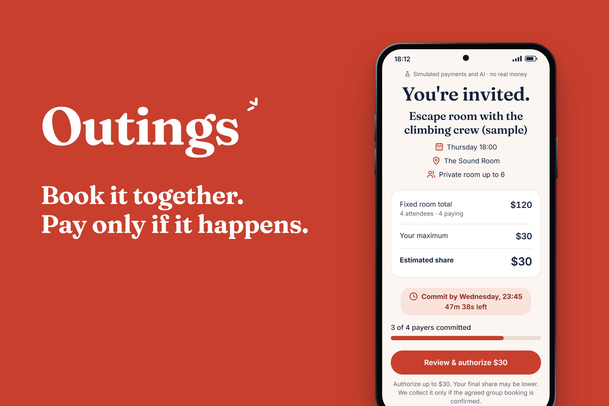

**Judges:** the [judge guide](docs/JUDGE_GUIDE.md) walks you through the whole product in about 10 minutes.

## The idea in one karaoke night

Six friends want a **$100 karaoke room** for Maya's birthday, and they're covering Maya.

| | What happens |
|---|---|
| 🗳️ **Vote** | Everyone privately answers "What would you personally pay?" Most say **$20**. Nobody sees who said what. |
| 🧮 **Match** | The app does the sum: $100 ÷ 5 people paying = **$20 each**. Right on budget. |
| 🔒 **Hold** | Each payer puts a PayPal hold on $20. A hold is not a charge. Maya holds nothing. |
| ⏰ **Deadline** | Everyone in? Each pays exactly **$20**. Someone missing? Every hold is released and nobody pays. |

And if the crew grows to ten paying? Same $100 room, so each pays **$10** and the other $10 of every hold is released.

## How it works

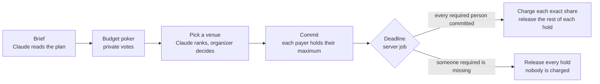

1. **Brief.** Type the plan in your own words, or pick a starter. Claude pulls out the activity, date, group size and budget.
2. **Budget poker.** Everyone privately picks what they'd personally pay. The amounts fit the outing, and the API never returns anyone else's vote.
3. **Reveal.** Opens once 3 in 4 people have voted, and never with fewer than 3 votes. It shows how many chose each amount, never who.
4. **Pick a venue.** Claude ranks the venues. Every card shows your share, and it updates the moment you cover a guest.
5. **Commit.** Each payer reviews the exact terms and authorizes their maximum through PayPal. Nothing is charged yet.
6. **Deadline.** A durable server job, not a browser timer and not the AI, freezes the roster and decides. It charges penny-exact shares, or releases every hold. If a charge fails midway, it releases the rest and refunds what was taken.

The same six steps on screen. Every picture is a real capture of the app; the demo screens run on the labelled payment simulator and sample AI text.

<p>
  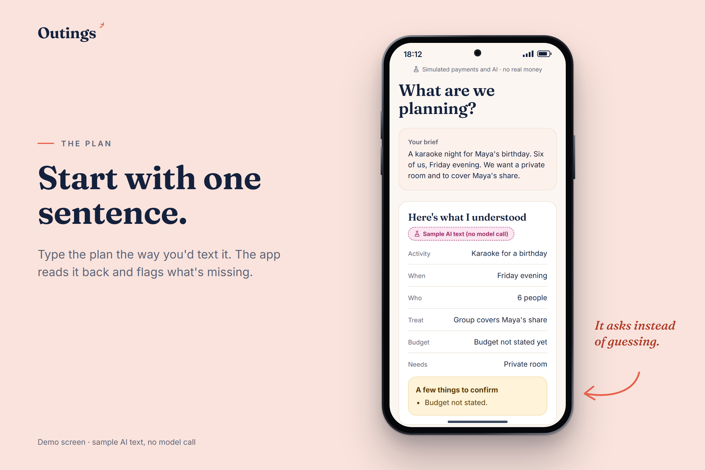
  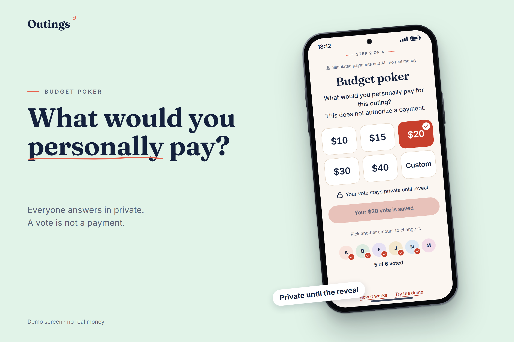
</p>
<p>
  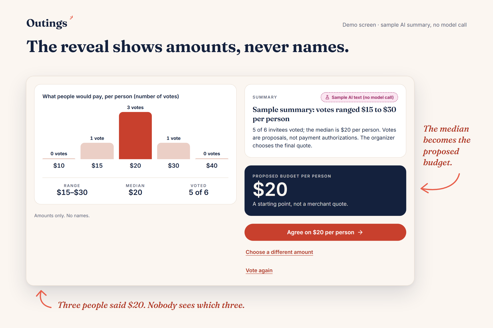
  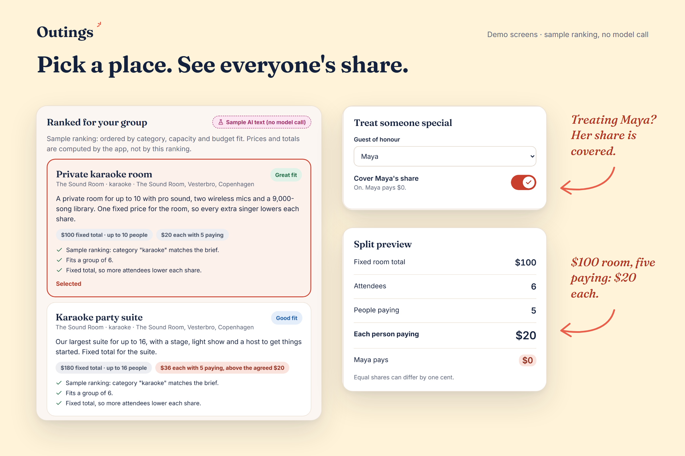
</p>
<p>
  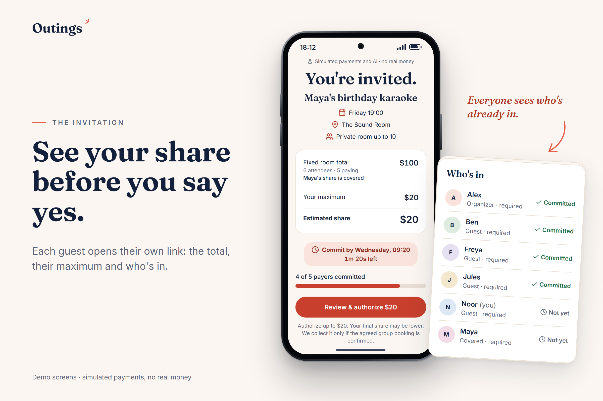
  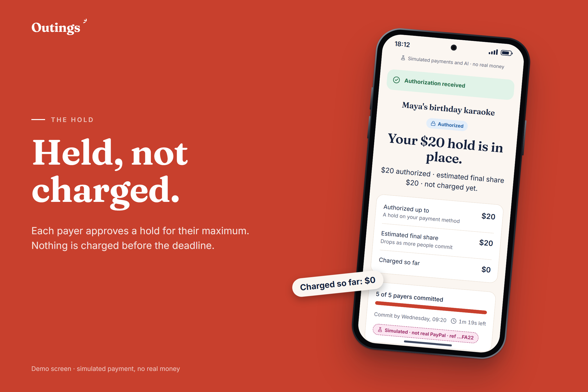
</p>

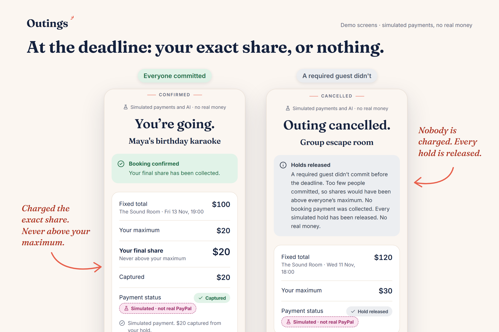

Venues see every booking and every dollar in an [AG Studio](docs/research/AG_STUDIO.md) dashboard.

<p>
  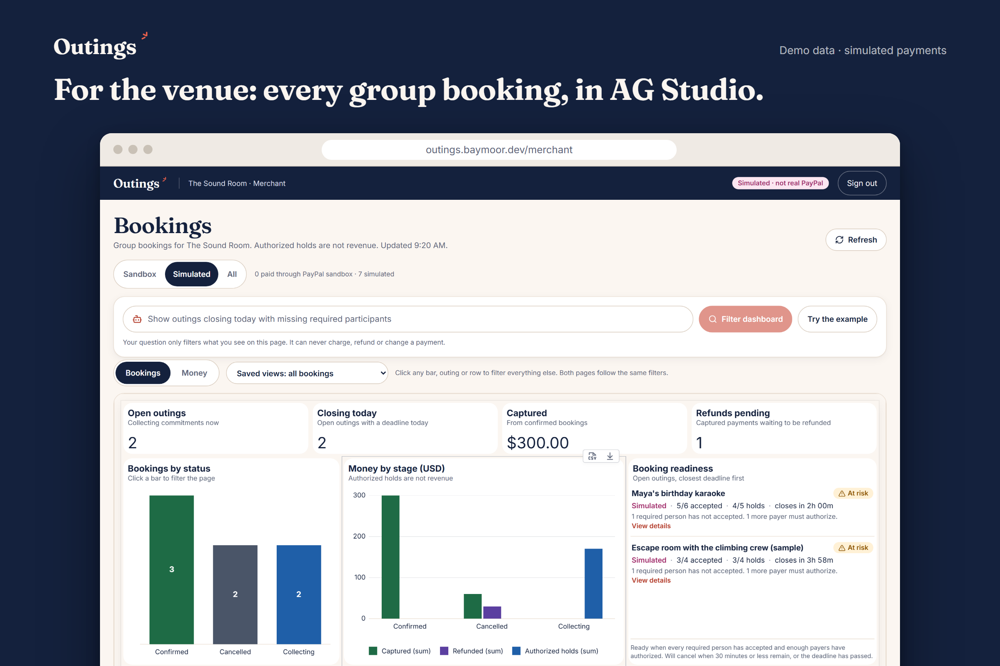
  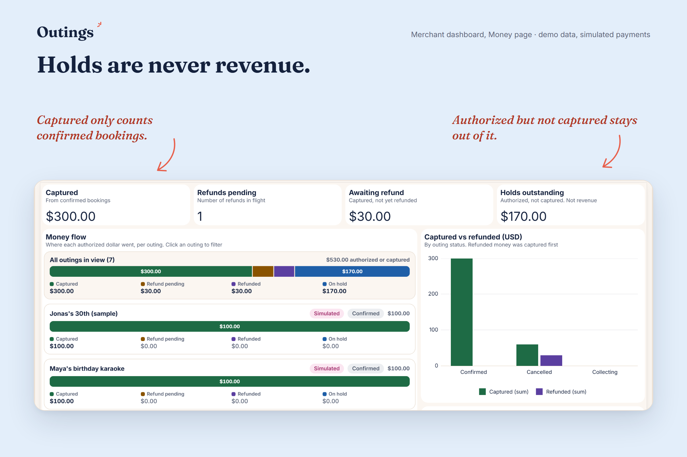
</p>

**How AG Studio and AG Grid are used.** The dashboard is one AG Studio report with two pages, Bookings and Money. It has two custom widgets (Booking Readiness and Money flow), KPIs and charts that cross-filter each other, saved views and an AG Grid bookings table. AG Studio's own agent panel answers read-only questions through our server-side Claude proxy.

## How PayPal is used

Each payer approves a PayPal **Orders v2** order with intent `AUTHORIZE` for their own maximum, so PayPal places a hold and charges nothing. At the deadline the server uses **Payments v2** to capture each exact share as a final capture, which makes PayPal release the rest of the hold, or to void every authorization. If one capture fails, the rest are voided and the captured ones refunded. Every call carries a `PayPal-Request-Id`, so a retry can never charge twice.

## Where AI helps, and where it stops

Claude reads the brief, suggests vote amounts, ranks venues, summarizes the vote, drafts the organizer's plan and turns a venue's question into a dashboard filter.

**It never decides money.** Every answer is schema-validated and [re-checked](lib/ai/validate.ts) against real data before anyone sees it. Shares, caps and every payment decision come from [plain rules](lib/domain/policy.ts) with tests. More in the [architecture](docs/ARCHITECTURE.md).

## What is real

| Piece | Status |
|---|---|
| PayPal Orders v2 (authorize, under-capture, void, refund) | **Verified in the PayPal sandbox**, including one full outing settled through the app ([evidence](docs/evidence/README.md)) |
| Deadline engine, splitting, consent, access control | Real code in every mode. 552 automated tests, most against a real Postgres, plus 8 browser tests ([testing](docs/TESTING.md)) |
| Claude | Real API when `OUTINGS_ANTHROPIC_API_KEY` is set, as on the live demo, for outings that signed-in judges create. Demo outings (the seeded ones and every `/demo` story) always use a deterministic parser labelled **Sample AI text (no model call)**, and so does every outing when no key is set. **Verified against the real API** on the hosted demo on 11 Nov 2026: a full `scripts/ai-smoke.ts` run passed 12 of 13 checks, and the one that failed (venue ranking) was fixed and then passed 3 of 3 reruns. |
| Payments on demo outings, or without PayPal keys | A simulator labelled **Simulated · not real PayPal** on every screen. Demo outings use it even when PayPal keys are set. |
| Who gets what on the live demo | **Anyone:** the `/demo` stories, invitation links, the venue dashboard's demo sign-in and its plain-language filter (sample parser). **Signed-in judges** (`/judge/login`): their own outings on `/new` with real Claude and PayPal sandbox, the AG Studio assistant, and Claude behind the filter. |
| Venues | Five fictional Copenhagen venues with a demo catalogue. A confirmed outing means the group's money was collected for the venue, not that a real venue reserved anything. |

Limits and the threat model: [security and limitations](docs/SECURITY_AND_LIMITATIONS.md).

## Run it (about 5 minutes)

Needs Node 22.12 or newer and Postgres 16.

```bash
npm ci
cp .env.example .env.local
# as a Postgres superuser:
#   CREATE ROLE outings LOGIN PASSWORD 'outings';
#   CREATE DATABASE outings OWNER outings;
npm run db:migrate && npm run db:seed
npm run dev        # http://localhost:3000
npm run worker     # second terminal: the deadline worker
```

Open `/new`, pick a starter, and use the **Acting as** bar to play every person from one browser. The [judge guide](docs/JUDGE_GUIDE.md) has the full path, PayPal sandbox setup and the test commands.

The judge sign-in is off locally unless you set `JUDGE_PASSWORD`. With it set, `/new`, creating an outing, the AG Studio assistant and Claude behind the venue's filter need a sign-in at `/judge/login` (username `judge`, or `JUDGE_USERNAME`).

## Built with

Next.js 16 · TypeScript (strict) · Postgres 16 with Drizzle · PayPal Orders v2 and Payments v2 · Claude Sonnet 5.5 (structured outputs) · AG Studio and AG Grid · Vitest and Playwright · hosted on DigitalOcean with Docker Compose and Caddy

**Tools used to build it:** AI coding help from Claude Code (Anthropic), and Claude Design for the mockups. The full disclosure is in the [submission notes](docs/HACKATHON_SUBMISSION.md#ai-tool-disclosure).

## Docs

- **For judges:** [judge guide](docs/JUDGE_GUIDE.md) · [architecture](docs/ARCHITECTURE.md) · [security and limitations](docs/SECURITY_AND_LIMITATIONS.md) · [testing](docs/TESTING.md) · [PayPal evidence](docs/evidence/README.md)
- **For builders:** [product spec](docs/PRODUCT_SPEC.md) · [module contracts and API](docs/CONTRACTS.md) · [design system](docs/design/DESIGN_SYSTEM.md) · [PayPal research](docs/research/PAYPAL.md) · [deployment](docs/DEPLOYMENT.md) · [status](docs/HANDOFF_TO_CODEX.md) · [provenance](docs/PROVENANCE.md)

## License

MIT, see [LICENSE](LICENSE). AG Studio is commercial software used under its evaluation trial; AG Grid Community is MIT. Third-party notices: [provenance](docs/PROVENANCE.md).
