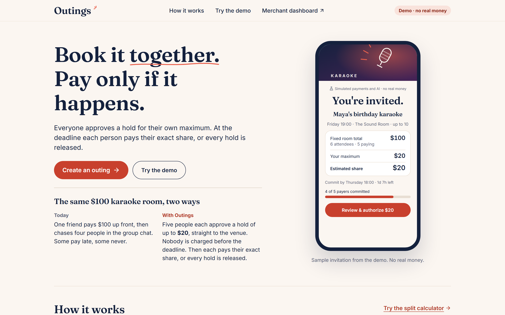
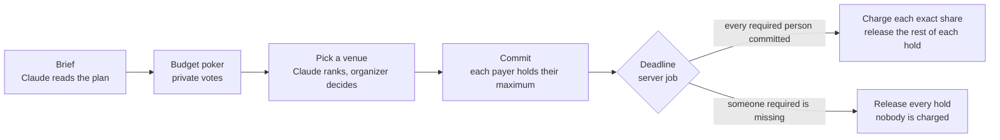
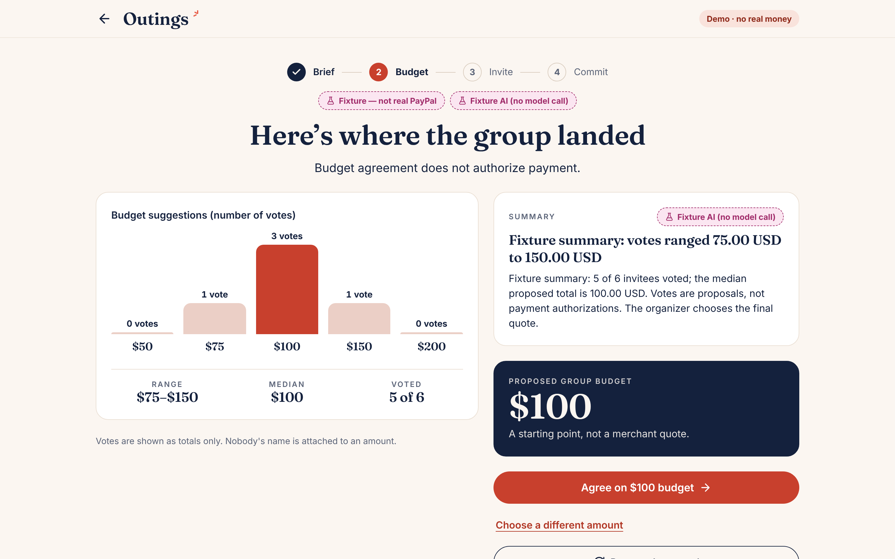
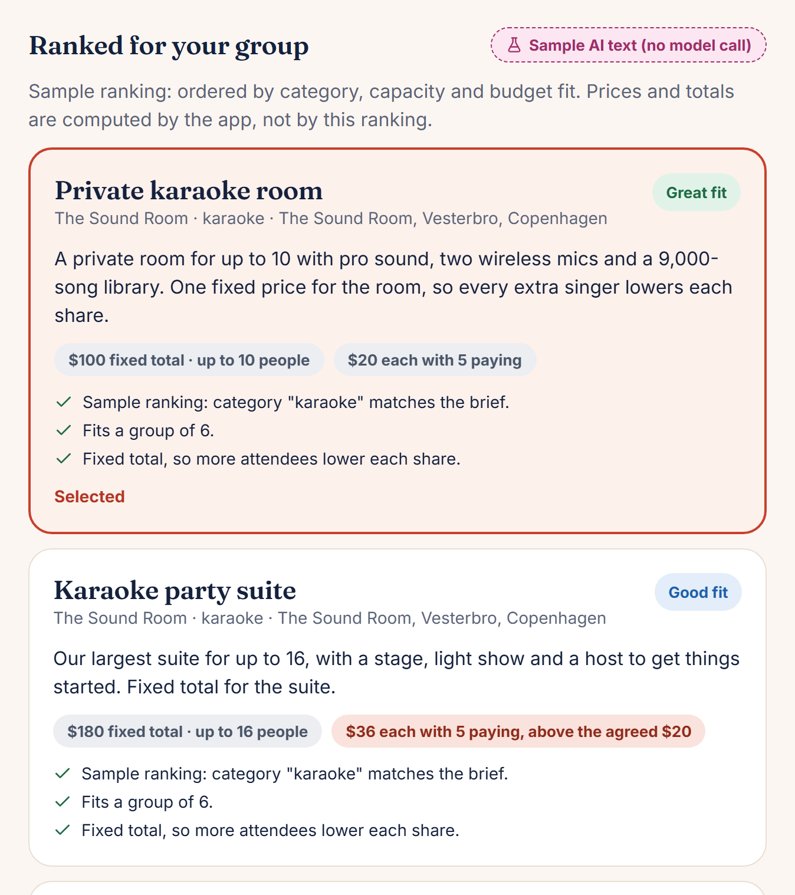
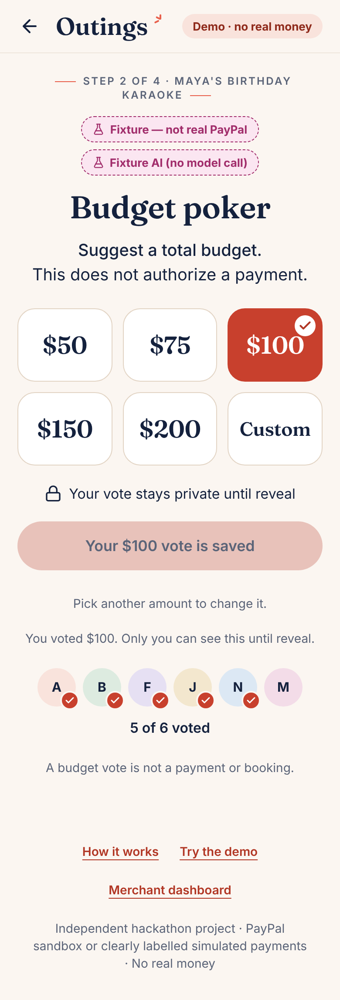
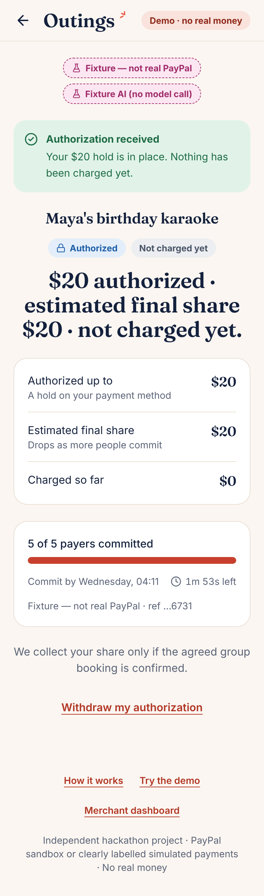
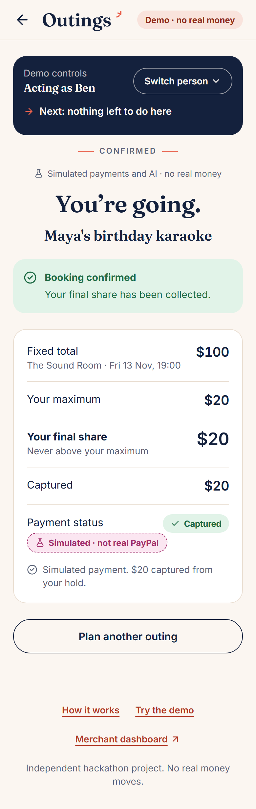
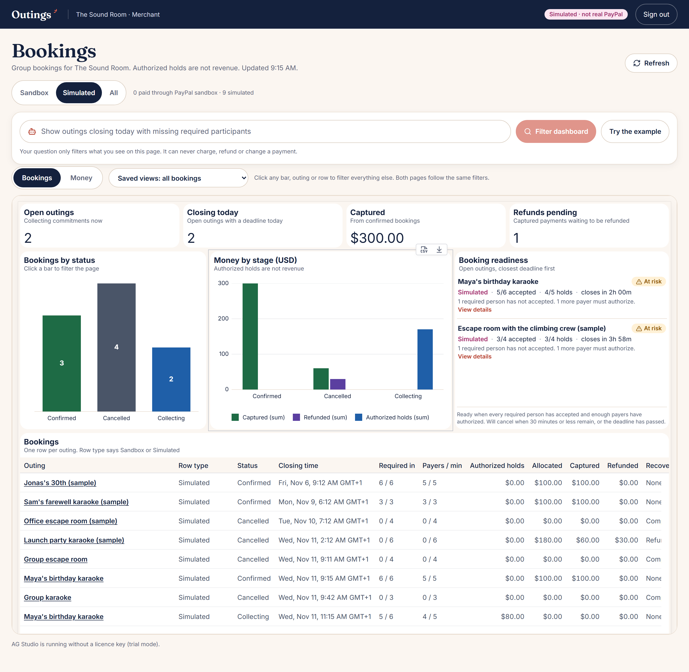

# Outings

> **Plan together. Commit individually. Pay only when everyone is in.**

Group plans die in the group chat. One friend fronts the money, three people go quiet, and nobody wants to be the one who says "that's a bit much for me".

**Outings fixes that.** Friends say privately what they'd each pay, everyone puts a PayPal hold on their own maximum, and at the deadline the server either books it and charges each exact share, or lets every hold go.

Built for the **PayPal AI Hackathon 2026**. PayPal **sandbox** only: no real money moves.



**Judges:** the [judge guide](docs/JUDGE_GUIDE.md) walks you through the whole product in about 10 minutes.

## The idea in one karaoke night

Six friends want a **$100 karaoke room** for Maya's birthday, and they're covering Maya.

| | What happens |
|---|---|
| 🗳️ **Vote** | Everyone privately answers "What would you personally pay?" Most say **$20**. Nobody sees who said what. |
| 🧮 **Match** | The app does the sum: $100 ÷ 5 people paying = **$20 each**. Right on budget. |
| 🔒 **Hold** | Each payer puts a PayPal hold on $20. A hold is not a charge. Maya holds nothing. |
| ⏰ **Deadline** | Everyone in? Each pays exactly **$20**. Someone missing? Every hold is released and nobody pays. |

And if the crew grows to ten paying? Same $100 room, so each pays **$10** and the other $10 of every hold is released.

## How it works



1. **Brief.** Type the plan in your own words, or pick a starter. Claude pulls out the activity, date, group size and budget.
2. **Budget poker.** Everyone privately picks what they'd personally pay. The amounts fit the outing, and the API never returns anyone else's vote.
3. **Reveal.** Opens once 3 in 4 people have voted, and never with fewer than 3 votes. It shows how many chose each amount, never who.

   

4. **Pick a venue.** Claude ranks the venues. Every card shows your share, and it updates the moment you cover a guest.

   

5. **Commit.** Each payer reviews the exact terms and authorizes their maximum through PayPal. Nothing is charged yet.
6. **Deadline.** A durable server job, not a browser timer and not the AI, freezes the roster and decides. It charges penny-exact shares, or releases every hold. If a charge fails midway, it releases the rest and refunds what was taken.

<p>
  
  
  
</p>

Venues see every booking and every dollar in an [AG Studio](docs/research/AG_STUDIO.md) dashboard.



## Where AI helps, and where it stops

Claude reads the brief, suggests vote amounts, ranks venues, summarizes the vote, drafts the organizer's plan and turns a venue's question into a dashboard filter.

**It never decides money.** Every answer is schema-validated and [re-checked](lib/ai/validate.ts) against real data before anyone sees it. Shares, caps and every payment decision come from [plain rules](lib/domain/policy.ts) with tests. More in the [architecture](docs/ARCHITECTURE.md).

## What is real

| Piece | Status |
|---|---|
| PayPal Orders v2 (authorize, under-capture, void, refund) | **Verified in the PayPal sandbox**, including one full outing settled through the app ([evidence](docs/evidence/README.md)) |
| Deadline engine, splitting, consent, access control | Real code in every mode. 527 automated tests, most against a real Postgres, plus 8 browser tests ([testing](docs/TESTING.md)) |
| Claude | Real API when `OUTINGS_ANTHROPIC_API_KEY` is set. Otherwise a deterministic parser labelled **Sample AI text (no model call)**. Real calls are not yet verified. |
| Payments without PayPal keys | A simulator labelled **Simulated · not real PayPal** on every screen |
| Venues | Five fictional Copenhagen venues with a demo catalogue. A confirmed outing means the group's money was collected for the venue, not that a real venue reserved anything. |

Limits and the threat model: [security and limitations](docs/SECURITY_AND_LIMITATIONS.md).

## Run it (about 5 minutes)

Needs Node 22.12 or newer and Postgres 16.

```bash
npm ci
cp .env.example .env.local
# as a Postgres superuser:
#   CREATE ROLE outings LOGIN PASSWORD 'outings';
#   CREATE DATABASE outings OWNER outings;
npm run db:migrate && npm run db:seed
npm run dev        # http://localhost:3000
npm run worker     # second terminal: the deadline worker
```

Open `/new`, pick a starter, and use the **Acting as** bar to play every person from one browser. The [judge guide](docs/JUDGE_GUIDE.md) has the full path, PayPal sandbox setup and the test commands.

## Built with

Next.js 16 · TypeScript (strict) · Postgres 16 with Drizzle · PayPal Orders v2 and Payments v2 · Claude Sonnet 5.5 (structured outputs) · AG Studio and AG Grid · Vitest and Playwright

## Docs

- **For judges:** [judge guide](docs/JUDGE_GUIDE.md) · [architecture](docs/ARCHITECTURE.md) · [security and limitations](docs/SECURITY_AND_LIMITATIONS.md) · [testing](docs/TESTING.md) · [PayPal evidence](docs/evidence/README.md)
- **For builders:** [product spec](docs/PRODUCT_SPEC.md) · [module contracts and API](docs/CONTRACTS.md) · [design system](docs/design/DESIGN_SYSTEM.md) · [PayPal research](docs/research/PAYPAL.md) · [deployment](docs/DEPLOYMENT.md) · [status](docs/HANDOFF_TO_CODEX.md) · [provenance](docs/PROVENANCE.md)

## License

MIT, see [LICENSE](LICENSE). AG Studio is commercial software used under its evaluation trial; AG Grid Community is MIT. Third-party notices: [provenance](docs/PROVENANCE.md).
