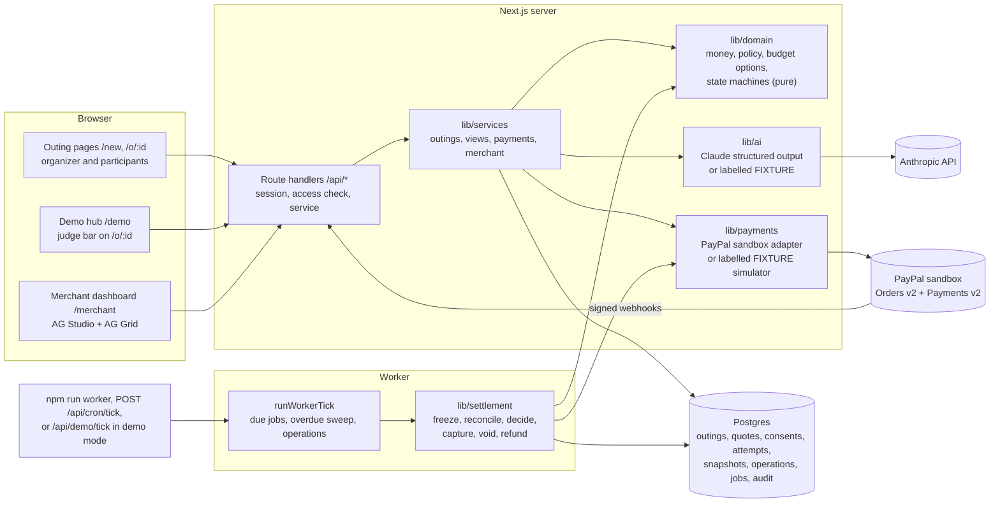
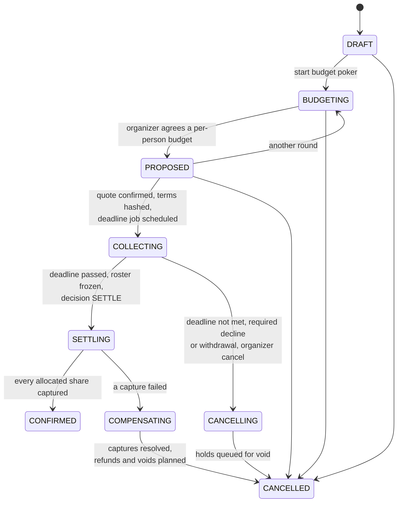
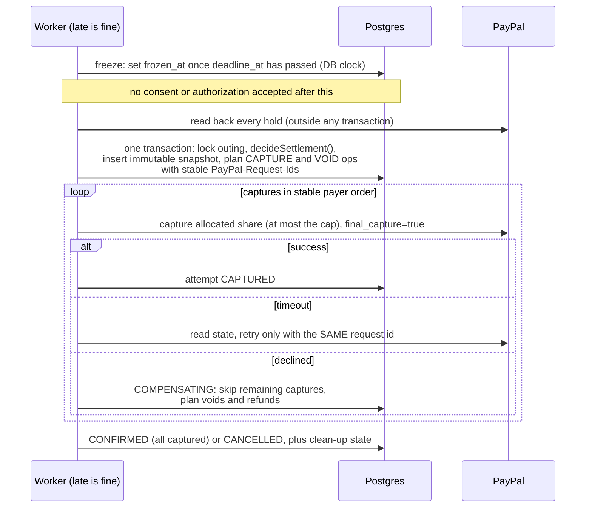

# Architecture

Outings is one Next.js 16 app on Postgres plus a worker that owns everything time-based; PayPal and Anthropic are called only from the server.

Related: [README](../README.md) · [judge guide](JUDGE_GUIDE.md) · [security and limitations](SECURITY_AND_LIMITATIONS.md) · [testing](TESTING.md) · [PayPal sandbox evidence](evidence/README.md) · [module contracts and HTTP API](CONTRACTS.md)

## Booking lifecycle

Booking status follows the transition table in [state-machine.ts](../lib/domain/state-machine.ts) (`OUTING_TRANSITIONS`); any other move throws `IllegalTransitionError`.

Money clean-up (`NONE`, `VOID_PENDING`, `REFUND_PENDING`, `NEEDS_ATTENTION`, `COMPLETE`) is a separate field, computed by `recomputeCleanup` in [operations.ts](../lib/settlement/operations.ts), and is `COMPLETE` only after the provider confirmed every void and refund.

## Settlement at the deadline

`runDeadlineSettlement` in [deadline.ts](../lib/settlement/deadline.ts) freezes, re-reads PayPal, decides once, and plans every provider call as a durable operation; `processDueOperations` in [operations.ts](../lib/settlement/operations.ts) sends them.

The worker is safe to run in several processes: jobs are claimed with `SKIP LOCKED`, operations are claimed atomically, and the snapshot is unique per outing ([runner.ts](../lib/jobs/runner.ts)). A sweep settles any overdue outing whose job was lost.

## Invariants

Each rule is enforced in code and pinned by a test; the database adds check constraints where it can.

| # | Invariant | Enforced in | Test |
|---|---|---|---|
| 1 | Money is integer minor units, one currency (USD) per outing | `assertMinor`, `SUPPORTED_CURRENCIES` in [money.ts](../lib/domain/money.ts) | [money.test.ts](../tests/domain/money.test.ts) |
| 2 | Shares sum exactly to the total and differ by at most one cent; extra cents go to the first payers in the immutable `sortKey` order | `equalSplit` in [money.ts](../lib/domain/money.ts), `stablePayerOrder` in [policy.ts](../lib/domain/policy.ts) | [money.test.ts](../tests/domain/money.test.ts) |
| 3 | No capture above the consented cap or the authorized amount | `decideSettlement` in [policy.ts](../lib/domain/policy.ts), `planPaymentOperation` in [plan.ts](../lib/payments/plan.ts), check `payment_capture_le_authorized` in [schema.ts](../lib/db/schema.ts) | [policy.test.ts](../tests/domain/policy.test.ts), [operations.test.ts](../tests/settlement/operations.test.ts) |
| 4 | Consent is bound to a hash of the exact terms (quote, merchant, offering, total, cap, capacity, minimum payers, activity time, deadline, policy, split rule, sponsored and required lists); any change needs new consent | `buildCommitmentTerms`, `hashTerms` in [policy.ts](../lib/domain/policy.ts) | [policy.test.ts](../tests/domain/policy.test.ts), [routes.test.ts](../tests/payments/routes.test.ts) |
| 5 | Commitments are accepted only while `COLLECTING`, not frozen, and before the server deadline | `collectionWindowOpen` in [outings.ts](../lib/services/outings.ts) | [service.test.ts](../tests/payments/service.test.ts), [terms-time-audit2.test.ts](../tests/audit2/terms-time-audit2.test.ts) |
| 6 | Late, unverifiable or wrong-payee authorizations are never admitted and are voided (fail closed) | `decideSettlement` in [policy.ts](../lib/domain/policy.ts), `reconcileAttempt` in [reconcile.ts](../lib/settlement/reconcile.ts), `expectedPayeeFor` in [payments.ts](../lib/services/payments.ts) | [deadline.test.ts](../tests/settlement/deadline.test.ts), [payee.test.ts](../tests/payments/payee.test.ts), [settlement-audit.test.ts](../tests/audit/settlement-audit.test.ts) |
| 7 | Settlement is decided once per outing under a row lock; no provider call runs inside a transaction | `runDeadlineSettlement` in [deadline.ts](../lib/settlement/deadline.ts) | [deadline.test.ts](../tests/settlement/deadline.test.ts) |
| 8 | Every provider mutation has an outbox row and a stable `PayPal-Request-Id`; a timeout is `UNKNOWN` and is reconciled before any retry | `operationRequestId` in [plan.ts](../lib/payments/plan.ts), [operations.ts](../lib/settlement/operations.ts) | [operations.test.ts](../tests/settlement/operations.test.ts) |
| 9 | A failed capture never confirms the booking and never moves its share onto others; completed captures are refunded | [operations.ts](../lib/settlement/operations.ts) | [operations.test.ts](../tests/settlement/operations.test.ts), [compensation.spec.ts](../tests/e2e/compensation.spec.ts) |
| 10 | AI never decides money, eligibility, deadlines or provider calls; FIXTURE output is labelled | [validate.ts](../lib/ai/validate.ts), [budget-options.ts](../lib/domain/budget-options.ts) | [ai.test.ts](../tests/ai/ai.test.ts), [budget-options.test.ts](../tests/domain/budget-options.test.ts) |

## AI boundary

The model extracts facts and drafts suggestions; deterministic code validates every field before it is shown or stored ([validate.ts](../lib/ai/validate.ts)).

- `extractBrief`: a budget the brief does not state is dropped; categories must exist in the catalogue.
- `proposeOfferings`: only real, active offerings that fit the group survive; prices come from the database.
- `summarizeReveal`: sees an anonymous vote distribution; an out-of-range suggested amount is replaced by the median.
- `draftPlan`: `validatePlanDraft` drops (never fixes) invalid offerings, times, deadlines and sponsors.
- `dashboardQuery` and the [AG Studio proxy](../app/api/merchant/ai/studio/route.ts): read-only filters and view tools only; no capture, void, refund or edit tool exists.

**Consistent answers.** The model is Claude Sonnet 5.5 at `low` effort with structured output (`output_config.format`), which fixes the shape of every answer. Sonnet 5.5 rejects sampling parameters, so there is no temperature to turn down; the [prompts](../lib/ai/prompts.ts) get consistency from structure instead, following Anthropic's prompting guidance for this model. Each task lists its decision rules in the order to apply them, with a tie-break (the ranker has an explicit category, group, budget and needs rubric; the planner uses the same slot and deadline rules as the sample planner). The tasks with judgement calls carry worked examples. Ranking and planning end with a think-first line and get a larger `max_tokens`, because with structured output the model can only reason in its thinking, which counts toward that limit. The effect on the real API is not yet measured: [ai-smoke.ts](../scripts/ai-smoke.ts) needs the owner's key.

Budget votes are per person ("what would you personally pay?"). The vote amounts are sized per outing by `chooseBudgetOptions` in [budget-options.ts](../lib/domain/budget-options.ts). The AI's five suggested amounts are used only if they are whole dollars, strictly increasing, at most 10x apart, and contain the app's own anchor, which also catches a model answering with whole-group totals. Otherwise the code builds 0.5x, 0.75x, 1x, 1.5x, 2x around that anchor: the brief's per-person budget, else its total divided by the people paying, else the lower median of what matching catalogue offerings cost per person, else $20.

The agreed amount is compared with each offering by [budget-fit.ts](../lib/domain/budget-fit.ts): share = booking total / people paying, where the booking total is a fixed price, or a per-attendee price times the people coming. A covered guest comes but does not pay, so they raise the share under both models. The ranker is handed these shares and never computes one; the organizer's venue cards recompute them from the live roster. This is display and ranking only: quotes, caps and settled shares still come from `policy.ts` and `money.ts`. Outings created before per-person voting keep `budget_unit = TOTAL`, and every label and comparison follows the outing's own unit.

## Demo and judge mode

`DEMO_FIXTURES_ENABLED=true` turns on the labelled simulators (when no keys are set) and the demo surfaces; with it off, every `/api/demo/*` route, the fixture approval and the merchant demo login answer 404.

- Five starters on `/new` ([starters.ts](../lib/demo/starters.ts)) map to five demo merchants: The Sound Room plus four fictional `FIXED_TOTAL` venues ([venues.ts](../lib/demo/venues.ts)), each with its own merchant dashboard.
- Four one-click scenarios on `/demo` ([scenarios.ts](../lib/demo/scenarios.ts)): settles on time, one holdout, capture fails, ten-person group.
- The judge bar on `/o/:id` shows who the browser acts as and what everyone else still has to do (`judgeBoard` in [judge.ts](../lib/demo/judge.ts), pure, built only from the viewer's own `OutingView`).
- Persona switch: `authorizePersonaSwitch` in [judge-persona.ts](../lib/demo/judge-persona.ts) behind [POST /api/demo/persona](../app/api/demo/persona/route.ts). Threat model: [security and limitations](SECURITY_AND_LIMITATIONS.md).

## Failure handling

API errors are JSON with a code and a plain message, never a stack trace (`errorResponse` in [http.ts](../lib/http.ts)); the PayPal browser redirects are the one exception.

| Failure | Response |
|---|---|
| Database or network briefly unreachable ([transient-errors.ts](../lib/transient-errors.ts)) | 503 `TEMPORARILY_UNAVAILABLE`, `Retry-After: 30` |
| Server closes an idle pooled connection | Pool `error` listener logs it, next query reconnects; connect timeout 10 s ([client.ts](../lib/db/client.ts)) |
| Body fails the schema | 400 `INVALID_INPUT`, plain message, offending paths in `fields` |
| PayPal return or cancel | A 303 redirect, not JSON: a malformed or unknown attempt id, or no session for its outing, lands on the neutral `/?payment=signin`; a payment error lands on the outing with `?payment=failed` ([return route](../app/api/payments/paypal/return/route.ts)) |
| PayPal timeout or 5xx | Operation `UNKNOWN`, reconciled from PayPal before any retry |
| Anything else | 500 `INTERNAL`, "Nothing was charged by this request" |

Module ownership and the HTTP API: [CONTRACTS.md](CONTRACTS.md). Rules in full: [product spec](PRODUCT_SPEC.md). Next: [how each claim is tested](TESTING.md).
