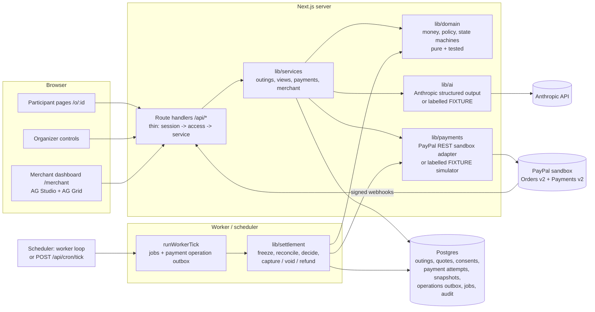
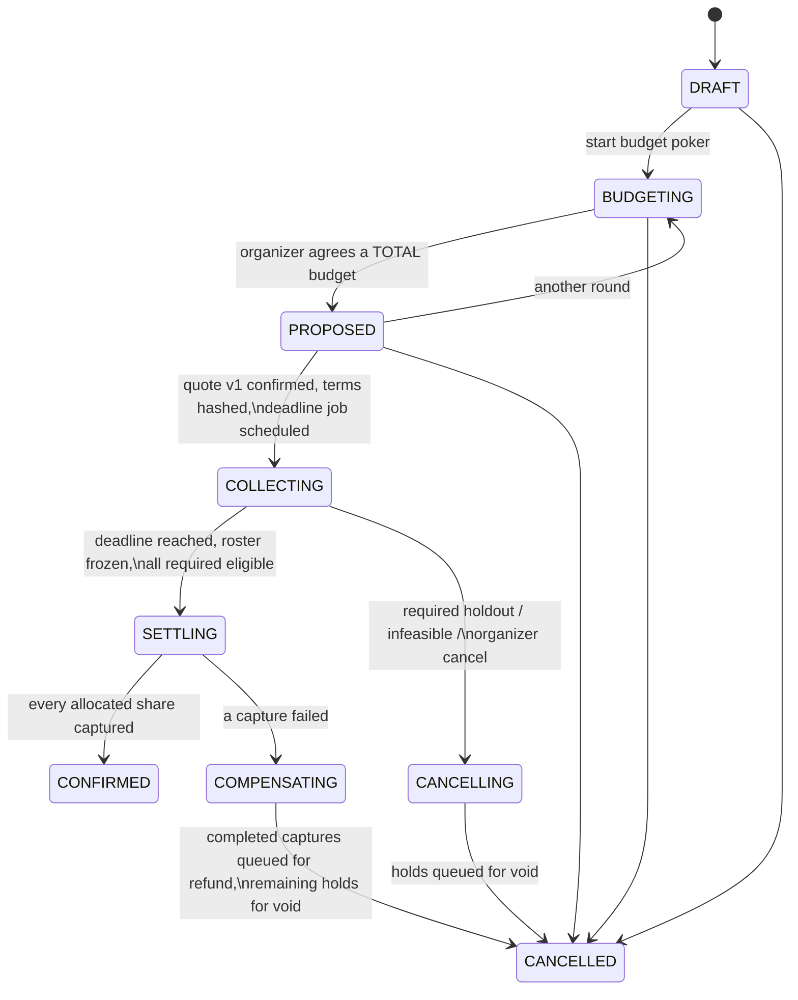

# Architecture

Outings is a single Next.js 16 (App Router) application backed by Postgres, with a separate worker process (or an authenticated scheduler hitting `/api/cron/tick`) that owns everything time-based. PayPal and Anthropic are reached only from the server.



## Booking lifecycle



Money clean-up (`NONE → VOID_PENDING / REFUND_PENDING → COMPLETE`, or `NEEDS_ATTENTION`) is tracked separately from booking status and only reaches `COMPLETE` when the provider confirmed every void/refund.

## Settlement sequence at the deadline

```mermaid
sequenceDiagram
  participant W as Worker (late is fine)
  participant DB as Postgres
  participant PP as PayPal
  W->>DB: CAS freeze (frozen_at) where deadline_at <= now()
  Note over W,DB: no new consent / authorization accepted after this
  W->>PP: read back orders/authorizations (outside any transaction)
  W->>DB: tx: lock outing, decideSettlement(), insert immutable snapshot,\nplan CAPTURE/VOID operations (stable PayPal-Request-Id)
  loop captures in stable payer order
    W->>PP: capture allocated share (<= cap), final_capture=true
    alt success
      W->>DB: attempt CAPTURED
    else timeout
      W->>PP: read state; retry only with SAME request id if not done
    else declined
      W->>DB: COMPENSATING: skip remaining captures,\nplan VOIDs + REFUNDs
    end
  end
  W->>DB: CONFIRMED (all captured) or CANCELLED (+ clean-up state)
```

## Invariants (enforced in code, most also in tests / DB constraints)

1. Money is integer minor units; one currency (USD) per outing.
2. `sum(allocations) == quote.total`; allocations differ by at most one cent; extra cents go to the first payers in the immutable `sortKey` order.
3. No capture above the consented cap or the authorized amount (`decideSettlement`, `planPaymentOperation`, DB check `captured_minor <= authorized_minor`).
4. Consent is bound to a terms hash (total, date, merchant, cap, deadline, sponsored + required lists, split rule). Any change → new hash → renewed consent.
5. Commitments are accepted only while `status = COLLECTING`, `frozen_at IS NULL` and server `now < deadline_at`.
6. Eligibility uses provider-verified authorization timestamps; late or unverifiable authorizations are never admitted (fail closed) and are voided.
7. Settlement is evaluated once per outing (unique snapshot) under a row lock; provider calls never run inside an open transaction.
8. Every provider mutation has a durable outbox row with a stable `PayPal-Request-Id`; timeouts are `UNKNOWN` and reconciled before any retry.
9. Partial capture failure never confirms the booking and never redistributes a failed share; completed captures are refunded.
10. AI never decides money, eligibility, deadlines or provider operations; FIXTURE outputs are labelled.

## Modules

See `docs/CONTRACTS.md` for module ownership and the HTTP API, and `docs/PRODUCT_SPEC.md` for the rules.
